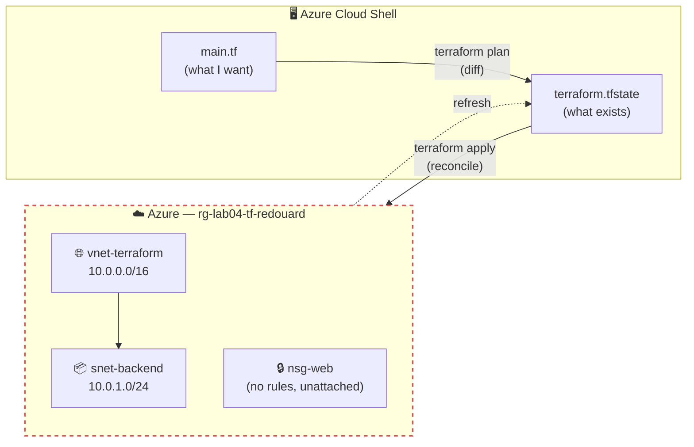
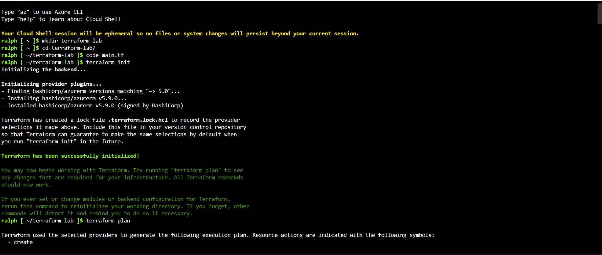
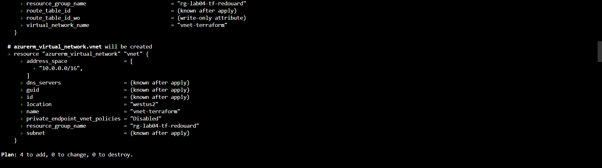
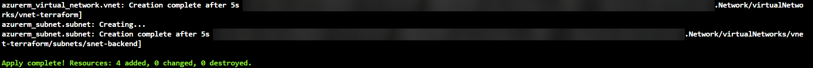
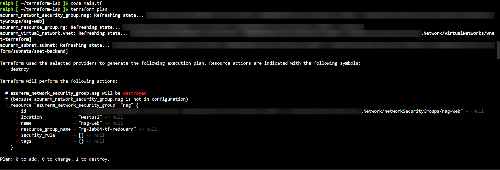
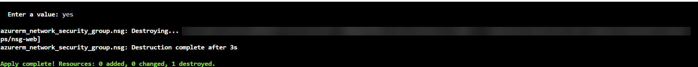
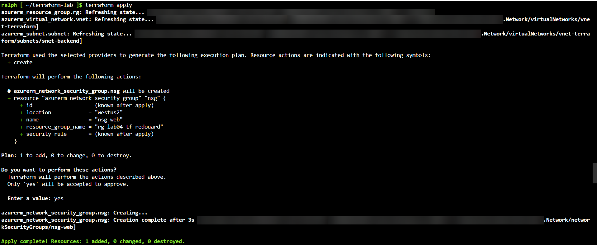
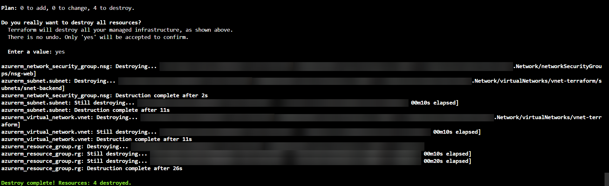

# Azure Infrastructure as Code with Terraform

> **The Build Log — Lab 004 of 12**
> *Lab 002's network took an hour of clicking. This is the same network in 50 lines of text, built in 40 seconds, and deleted in one command.*

[](#)
[](#)
[](#)
[](#)
[](LICENSE)

> **Author:** Ralph Edouard II
> **Series:** The Build Log — Azure Fundamentals
> **Status:** ✅ Completed

---

## 🙏 Credit

Lab 004 is part of a structured Azure curriculum **Jhante Charles** built for me to accelerate my Cloud Security Engineer transition. The lab design and instructions are his. The execution, the `main.tf` as committed here, the walkthrough video, security analysis, and writeup are mine.

---

## 🎬 Watch Me Build This Lab

[**▶ Lab 04 — Terraform on Azure: init, plan, apply, destroy**](https://www.loom.com/share/17f5472695d5446dba6ee221688aeaf0)

---

## 👋 About This Lab

Three labs of clicking through the Azure Portal. This one stops.

Lab 004 is the first time in the series the infrastructure is a file. I wrote a `main.tf` describing a resource group, a VNet, a subnet, and an NSG, and let Terraform build it. Then I deleted a block from the file and watched Terraform remove the real resource to match. Then I tore the whole thing down with one command.

Coming from SysAdmin work, this is the one that changes how you think about infrastructure. The portal is a place you *do* things. A Terraform file is a place you *declare* things — and the tool does the doing.

---

## 📌 What I Built

Four resources, all from [`main.tf`](main.tf):

| Resource | Name | Notes |
| --- | --- | --- |
| Resource Group | `rg-lab04-tf-redouard` | West US 2 |
| Virtual Network | `vnet-terraform` | `10.0.0.0/16` |
| Subnet | `snet-backend` | `10.0.1.0/24` |
| Network Security Group | `nsg-web` | Empty — no rules, not attached |

Provider: `hashicorp/azurerm ~> 5.0`, resolved to **5.9.0**. Jhante's doc pins `~> 3.0`; I moved it forward two major versions. Everything in this lab works unchanged on 5.x.

---

## 🏗️ Architecture



The loop that matters: `main.tf` says what should exist, `terraform.tfstate` records what Terraform last built, and Azure is what's actually there. `plan` diffs the first two. `apply` makes Azure match the file and updates state. Remove a block from the file, and the next plan says *destroy* — because the file is the source of truth, not the portal.

---

## 🎯 What I Practiced

- Writing an HCL configuration with provider pinning and resource references
- The core workflow: `init` → `plan` → `apply` → `destroy`
- Reading a plan — `+ create`, `- destroy`, `(known after apply)`, and the summary line
- Implicit dependency ordering (`azurerm_resource_group.rg.name` makes the VNet wait for the RG)
- **Drift in both directions:** removing a block → Terraform destroys the resource; re-adding it → Terraform recreates it
- Understanding what state is, why it's sensitive, and what never gets committed
- Reading the lock file and why it ships with the code

---

## ✅ What You'll Need

| Requirement | Notes |
| --- | --- |
| Active Azure subscription | Free Tier works |
| Azure Cloud Shell (Bash) | Terraform is pre-installed. Nothing to install locally. |
| About 45 minutes | — |

---

## 🛠️ How I Built It

### Phase 1 — Cloud Shell

Open Cloud Shell from the portal toolbar (`>_`), confirm **Bash**, then:

```bash
mkdir terraform-lab && cd terraform-lab
code main.tf
```

### Phase 2 — The configuration

Paste [`main.tf`](main.tf). Change `rg-lab04-tf-redouard` to your own name. `Ctrl+S`, `Ctrl+Q`.

The file has four resource blocks and a provider block. The comments in it explain each one — I left Jhante's comments in because they're better than anything I'd write for a first Terraform file.

### Phase 3 — init, plan, apply

```bash
terraform init
```

Downloads the azurerm provider into `.terraform/` and writes `.terraform.lock.hcl`. That lock file pins the exact provider version — commit it.



```bash
terraform plan
```

Read-only. Shows what *would* happen. Four resources, `+ create` on each, `(known after apply)` for anything Azure assigns at creation.



```bash
terraform apply
```

Shows the plan again, asks for the full word `yes`, then builds. The resource group goes first — Terraform worked out the dependency order from the references in the file.



### Phase 4 — Drift: remove a resource from the file

`code main.tf`, delete the entire `azurerm_network_security_group` block, save, close.

```bash
terraform plan
```



> `# azurerm_network_security_group.nsg will be destroyed`
> `# (because azurerm_network_security_group.nsg is not in configuration)`

That line is the whole lab. The NSG still exists in Azure. The state file still records it. But the file no longer declares it, so Terraform plans to remove it.

```bash
terraform apply
```



### Phase 5 — Drift the other way: add it back

Paste the NSG block back in. `terraform plan` → `1 to add`. `terraform apply` → `1 added`. The RG, VNet, and subnet are untouched — Terraform only acts on the diff.



### Phase 6 — Destroy

```bash
terraform destroy
```

Reads state, lists all four, asks for `yes`, removes them in reverse dependency order.



> **Why `destroy` and not the portal?** If you delete the resource group in the portal, the state file still thinks those resources exist. The next `plan` errors out. `destroy` keeps state and reality in sync. This is the Terraform version of Lab 001's cleanup rule.

---

## 🔐 Security Things I Noticed

Still early on the cloud security side. Observations, not expert guidance:

- **State is sensitive.** `terraform.tfstate` holds every resource ID, every attribute Terraform knows about, and — if the config had any — secrets in plaintext. It is in [`.gitignore`](.gitignore) and it stays there. Committing state to a public repo is one of the most common IaC mistakes, and the file in this lab has my subscription ID on every line.
- **The NSG protects nothing.** `nsg-web` has zero rules and no `azurerm_subnet_network_security_group_association`. It exists, it's named like a firewall, and it's attached to nothing. In Lab 002 I attached an NSG in the portal and wrote a rule. Here, the file doesn't — and Terraform did exactly what the file said. *Declarative* means it builds what you declared, not what you meant.
- **`plan` without `-out`.** Terraform warned me: *"You didn't use the -out option to save this plan, so Terraform can't guarantee to take exactly these actions."* In a pipeline you'd `plan -out=tfplan` and `apply tfplan` so the reviewed plan is the executed plan. Not a lab concern. A production one.
- **The lock file is a supply-chain control.** `.terraform.lock.hcl` pins the provider to 5.9.0 with its hash. Committed, it means the next `init` — mine or anyone's — gets the exact same provider, not whatever's newest.
- **Cloud Shell is ephemeral.** The session banner says files won't persist. They do, via the attached storage account — but the `.terraform/` directory and state live in that storage account too. That's a storage account with my state in it. Worth knowing where it is.
- **`default_outbound_access_enabled = true`** showed up in the plan on the subnet. Azure's default outbound internet access for VMs is something Microsoft is moving away from; the explicit answer is a NAT Gateway. Not touched here. Flagged.

---

## 💰 What This Cost

A resource group, a VNet, a subnet, and an NSG have no hourly charge. This lab cost nothing to run.

The real cost lesson is in the destroy: four resources gone in one command, in 40 seconds, with state and Azure left in sync. Compare to Lab 001.

---

## 🧰 Stuff That Tripped Me Up

**Terraform destroyed something I didn't tell it to destroy.**

I removed the NSG block from `main.tf` to see what would happen. The next plan said `1 to destroy`. For a second it felt like Terraform had decided something on its own. It hadn't — I had. The file is the declaration. Anything in state that's no longer in the file is, by definition, something I said shouldn't exist.

The portal reflex is "I'll delete it when I'm ready." The Terraform reality is "it's deleted when the file says so." That's a mental shift, and it's the one that makes IaC safe at scale — nobody's clicking, the file is reviewable, and the diff is the change request.

**Provider version.**
Jhante's doc uses `~> 3.0`. I used `~> 5.0` and got 5.9.0. Nothing in this lab broke, but the attribute names in plan output (`network_security_group_id_wo`, `private_endpoint_vnet_policies`) are 5.x additions you won't see on 3.x. If you're following along from the doc, expect slightly different plan output.

**`yes` means `yes`.**
`y` doesn't work. Terraform wants the whole word on apply and destroy. Deliberate.

---

## 🧠 What I Took Away

- The portal is where you do things. The file is where you declare them. Once you've had Terraform destroy something because you removed four lines, you don't confuse the two again.
- `plan` is the whole safety model. Every apply is a diff you already read.
- Three labs of resources I built by hand could be a folder of `.tf` files. Lab 002's network is 20 lines. Lab 003's Key Vault and role assignments are maybe 30 more.
- State is the thing to protect. Not the code — the state.
- The NSG that protects nothing is the best lesson in the lab. Terraform is a precise instrument for building exactly what you wrote, including the mistakes.

---

## 📚 References

- [Terraform AzureRM provider — Registry](https://registry.terraform.io/providers/hashicorp/azurerm/latest/docs)
- [Terraform state — HashiCorp](https://developer.hashicorp.com/terraform/language/state)
- [Dependency lock file — HashiCorp](https://developer.hashicorp.com/terraform/language/files/dependency-lock)
- [Sensitive data in state — HashiCorp](https://developer.hashicorp.com/terraform/language/state/sensitive-data)
- [Azure Cloud Shell overview — Microsoft Learn](https://learn.microsoft.com/azure/cloud-shell/overview)

---

## 🗺️ The Build Log Series

- [Lab 001 — Azure Static Website Hosting](https://github.com/redouard2/azure-static-website-lab)
- [Lab 002 — Two-Tier Web Application](https://github.com/redouard2/azure-2tier-vnet-lab)
- [Lab 003 — PaaS Migration + Key Vault](https://github.com/redouard2/azure-paas-keyvault-lab)
- **Lab 004 — Infrastructure as Code with Terraform** ← *you are here*
- Lab 005 — *coming soon*

---

*Part of my Cloud Security Engineer transition. Writing these up the way I'd want them written for me.*
